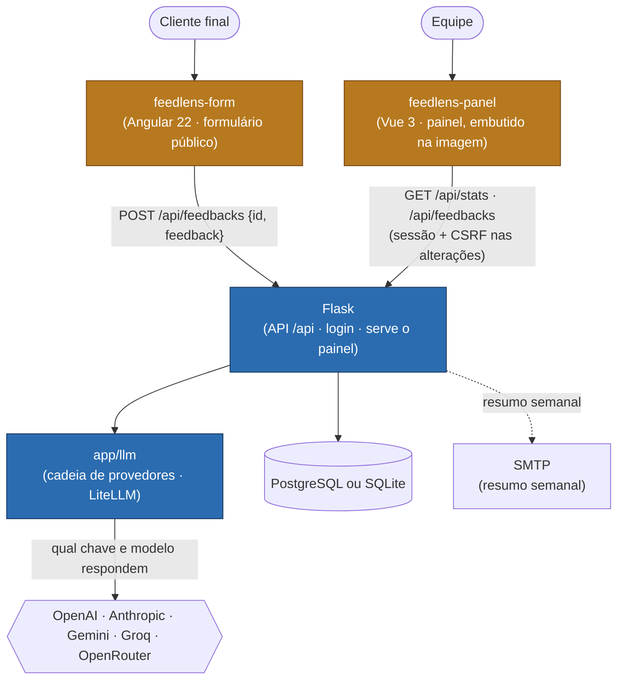
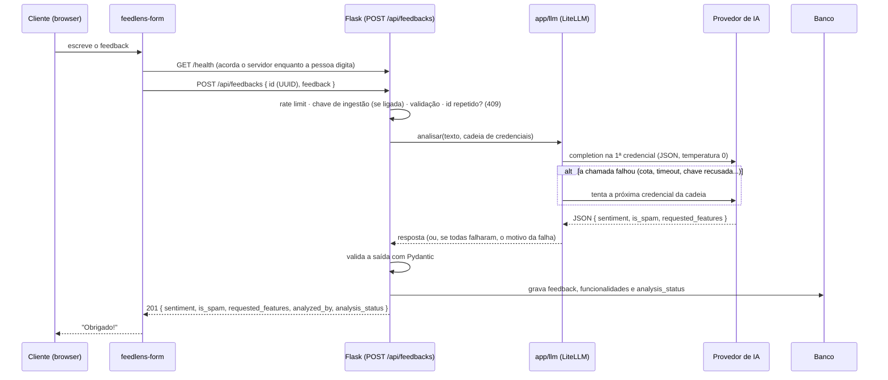

# Arquitetura do FeedLens

Este documento aprofunda o [README](./README.md): ele existe para quem precisa
**entender ou alterar** a arquitetura, não só usar o FeedLens. O README dá o mapa
e os comandos; aqui estão as fronteiras, o fluxo ponta a ponta de um feedback e o
**porquê** de cada decisão não óbvia.

Escopo: os componentes que vivem neste repositório (`app/`, `app/llm/`, `evals/` e
`migrations/`) e como se encaixam com o painel e o formulário, que vivem em
repositórios próprios (§1). Variáveis de ambiente, rotas e comandos estão no README.

---

## 1. Visão de contexto

Dois fronts e um backend, em **três repositórios**. Este é o backend; o
[painel](https://github.com/IannCarvalho/feedlens-panel) e o
[formulário](https://github.com/IannCarvalho/feedlens-form) são projetos
independentes (cada um com `package.json`, build e CI próprios). O backend serve a
API e, de quebra, o painel já compilado, que a imagem Docker baixa de um release.

| Componente | Onde | Stack | Papel | Fala com |
|---|---|---|---|---|
| `app/` | este repositório | Python 3.10+, Flask, SQLAlchemy | API REST, login do painel, análise, estatísticas, resumo por e-mail. Serve o painel instalado em `app/static/spa/`. | banco, provedores de LLM (via `app/llm`), SMTP |
| `app/llm/` | este repositório | LiteLLM, cryptography | Catálogo de provedores, cadeia de credenciais e a chamada à LLM com fallback | provedores de LLM |
| Painel | [feedlens-panel](https://github.com/IannCarvalho/feedlens-panel) | Vue 3, Vite, PrimeVue, Pinia | **Painel** da equipe: números, listas, correção, provedores | Flask, na mesma origem |
| Formulário | [feedlens-form](https://github.com/IannCarvalho/feedlens-form) | Angular 22, nginx | **Formulário público** do cliente final: uma tela, sem login | Flask, de outra origem (CORS) |
| `evals/` | este repositório | Python | Mede o prompt de classificação contra casos de teste | provedores de LLM (gasta cota) |

### Como os três repositórios se ligam

- **Painel → backend, em tempo de build.** O painel publica um release (tarball +
  `.sha256`) a cada tag. O `Dockerfile` deste repositório fixa a versão e o checksum
  (`ARG PANEL_VERSION`, `ARG PANEL_SHA256`) e baixa com `ADD --checksum`: o build
  falha se o arquivo não for exatamente o esperado. O painel continua **na mesma
  imagem e na mesma origem** da API, por isso o cookie de sessão e o CSRF não
  mudaram e não há CORS com credenciais. O `base` do Vite (`/static/spa/`) é um
  acordo entre os dois repositórios: o painel o grava no build e o Flask serve esse
  caminho.
- **Formulário → backend, em tempo de execução.** O formulário é um site estático
  que só conhece `POST /api/feedbacks` e `GET /health`; o endereço da API vem do
  `config.json`.
- **O contrato é a API, agora descrito em `openapi.yaml`.** A raiz do repositório
  tem um `openapi.yaml` (OpenAPI 3.1) com as rotas que os clientes consomem — a
  ingestão `POST /api/feedbacks` e tudo que o painel usa — e `tests/test_openapi_contract.py`
  prova que ele não mente: valida a própria spec e, para cada endpoint coberto,
  chama a API real (test client, LLM mockada) e confere corpo e status contra o
  esquema; uma rota coberta que suma ou mude de forma quebra o teste. Os tipos do
  painel (`src/types/api.ts`) e a tradução de status do formulário
  (`http-feedback.gateway.ts`) ainda são mantidos à mão, do outro lado da fronteira
  — gerá-los a partir do `openapi.yaml` fica para um PR futuro. Uma mudança que
  quebre uma resposta continua exigindo PR nos dois repositórios.
- **Funcionalidade que cruza API e tela:** PR no backend primeiro, compatível com o
  painel que está no ar → merge → PR no painel → tag → PR aqui subindo
  `PANEL_VERSION`. Remover algo da API só depois de o painel novo estar publicado.

A regra que organiza tudo: **o navegador nunca fala com a IA nem com o banco**. O
formulário só envia texto, o painel só lê e corrige pela API, e o Flask é a única
fonte de verdade sobre o banco e o único lugar onde uma chave de LLM é usada. Cada
seta é uma fronteira com um contrato.

---

## 2. O caminho de um feedback

O que acontece quando o cliente escreve *"Adoro o app, mas falta modo escuro"* no
formulário:

Pontos-chave do fluxo:

- **Nada gasta IA antes de passar nas checagens baratas.** A ordem é: rate limit,
  chave de ingestão, validação do corpo (JSON, `id` UUID, tamanho do texto),
  cabeçalhos BYOK e só então a checagem de `id` repetido. Quem não tem a chave de
  ingestão não grava nem gasta nada.
- **O `id` é gerado no navegador e reaproveitado nas tentativas.** Reenviar é
  seguro: um `409` significa "já recebemos", e o formulário o trata como sucesso.
- **O feedback é dado, não instrução.** As instruções vão na mensagem de sistema e
  o texto do cliente vai delimitado por `<feedback>…</feedback>`; um `</feedback>`
  dentro do texto é escapado para não fechar a delimitação.
- **A saída do modelo nunca é confiada como veio.** O Pydantic normaliza: sentimento
  desconhecido vira `INCONCLUSIVO`, `is_spam` ausente vira `false`, os códigos de
  funcionalidade viram `MAIÚSCULAS_COM_SUBLINHADO` (até 50 caracteres, no máximo 10
  por feedback) e itens malformados são descartados.
- **A resposta traz `analyzed_by`** (`provedor/modelo`) e `analysis_status`, então
  dá para saber quem analisou e se a IA chegou a responder (ver §3.4).

Do lado do painel, a equipe faz login (cookie de sessão), e o Vue lê
`GET /api/stats` e `GET /api/feedbacks`. Corrigir ou reanalisar um feedback são
`PATCH /api/feedbacks/<id>`, `POST /api/feedbacks/<id>/reanalyze` e, em lote,
`POST /api/feedbacks/reanalyze-pending`, sempre com o token CSRF.

| Operação | Rota | Quem pode |
|---|---|---|
| Enviar feedback | `POST /api/feedbacks` | Público; exige `X-API-Key` se `INGEST_API_KEY` estiver definida (ou `Origin` em `INGEST_PUBLIC_ORIGINS`, sob rate limit e teto diário) |
| Ler (listar, detalhe, estatísticas) | `GET /api/feedbacks`, `/api/feedbacks/<id>`, `/api/stats` | Sessão do painel ou `Bearer API_READ_TOKEN`; aberto só se nenhum dos dois estiver definido |
| Corrigir ou reanalisar | `PATCH /api/feedbacks/<id>`, `POST /api/feedbacks/<id>/reanalyze`, `POST /api/feedbacks/reanalyze-pending` (lote) | **Só** a sessão do painel + `X-CSRF-Token`; `403` sem `DASHBOARD_PASSWORD`. O lote tem rate limit próprio (`RATELIMIT_REANALYZE`) — cada feedback é uma chamada paga ao provedor |
| Gerir chaves de provedor | `/api/settings/providers…` | Sessão do painel + CSRF; exige `DASHBOARD_PASSWORD` e `FEEDLENS_ENCRYPTION_KEY` |

---

## 3. Decisões de arquitetura

### 3.1 Dois fronts separados: painel e formulário

Seria mais curto ter uma só aplicação com uma tela pública e outra privada. **Não é
assim** porque os dois têm públicos, riscos e ritmos de deploy diferentes:

- **O painel** é servido pelo próprio Flask (o release do painel é extraído em
  `app/static/spa/`, com `base: /static/spa/`). Estando na **mesma origem** da API,
  o cookie de sessão do login funciona sem CORS com credenciais. É uma SPA: o
  Flask entrega o mesmo `index.html` na raiz e nos deep-links, e o Vue Router
  escolhe a tela. Sem o painel instalado, a raiz responde `503` com a instrução
  para baixá-lo (`python scripts/fetch_panel.py`).
- **O formulário** não tem login, não mostra feedbacks de ninguém e fala só um
  contrato: `POST /api/feedbacks` com `{ id, feedback }`. O Flask **não** o serve,
  então o cookie de sessão do painel nunca chega a ele. Em produção ele é um site
  estático, de preferência em outro subdomínio, e a origem dele entra em
  `CORS_ORIGINS`.
- Dentro do formulário, a tela só conhece `FeedbackGateway.send(id, texto)`, que
  devolve `ok` ou um motivo (`invalid`, `busy`, `offline`, `unavailable`). O gateway
  HTTP e o de demonstração (mock) são intercambiáveis por `public/config.json`, sem
  recompilar.

**O custo dessa escolha** é que um site público não guarda segredo: com
`INGEST_API_KEY` ligada e sem a ingestão pública, o formulário recebe `401`.
Ver §4 e §6.

### 3.2 O prompt como contrato, medido por testes e por avaliação

O prompt que decide sentimento, spam e funcionalidades é `ANALYSIS_SYSTEM_PROMPT`
(`app/services/feedback_analyzer.py`). Ele define o que cada sentimento significa e
é deliberadamente conservador com spam: **na dúvida, não é spam**, porque um
feedback verdadeiro marcado como spam some do painel sem ninguém perceber.

Mudar o prompt sem medir é adivinhar. Por isso existem duas camadas:

- **Testes de contrato** (`pytest`, sem chamar LLM): o formato de saída que o
  backend lê, a delimitação do feedback e a proteção contra injeção.
- **Avaliação** (`evals/`, chama a LLM de verdade): casos de ajuste (`dev`) e casos
  reservados (`holdout`, rodar só no fim) cobrindo elogios curtos, ironia,
  perguntas, pedidos de funcionalidade, feedback sobre atendimento (que não pode
  virar spam) e spam de verdade. Falhas do provedor (cota, timeout) são contadas à
  parte, não como erro de classificação.

### 3.3 Multi-provedor via LiteLLM, com allowlist e três níveis de chave

O [LiteLLM](https://docs.litellm.ai/) dá uma interface única para OpenAI,
Anthropic, Google Gemini, Groq e OpenRouter. A cada análise, `app/llm` monta uma
**cadeia de credenciais** e usa a primeira que responder. De onde vem cada chave,
em ordem de precedência:

| Nível | Origem | Quando vale |
|---|---|---|
| 1. Requisição | Headers `X-LLM-Provider` + `X-LLM-Api-Key` (+ `X-LLM-Model`) | Vence tudo e usa **só** essa chave, nunca as do servidor |
| 2. Cofre | Chaves salvas no banco, cifradas, habilitadas, por `priority` | Editáveis pelo painel, sem redeploy |
| 3. Ambiente | `*_API_KEY` do servidor; `LLM_MODELS` define a ordem `provedor/modelo` | Para o que não estiver no cofre; sem `LLM_MODELS`, todo provedor com chave entra no modelo padrão |

Decisões por trás disso:

- **Allowlist de provedores.** O LiteLLM fala com dezenas de provedores, e alguns
  usam credenciais do **ambiente do servidor** (`bedrock/` usa o IAM da máquina,
  `ollama/` chama um host interno). Aceitar um prefixo arbitrário vindo de um header
  deixaria um cliente usar a nuvem do operador. Só os cinco provedores do catálogo
  (`app/llm/providers.py`), com chave explícita, são aceitos.
- **O provedor sai sempre do nosso prefixo.** O nome do modelo não pode ter `/`,
  exceto em Groq e OpenRouter, cujos catálogos têm ids `fabricante/modelo` (uma
  barra só). Assim `openrouter/google/gemma-4-31b-it:free` é o provedor
  `openrouter` com o modelo `google/gemma-4-31b-it:free`.
- **Fallback por falha de chamada ou de conteúdo.** Cota, timeout, conexão, chave
  recusada, modelo inexistente, resposta vazia e resposta que não vira JSON passam
  para a próxima credencial, cada uma com `LLM_TIMEOUT` e `LLM_MAX_RETRIES` (padrão
  30 s e 2 novas tentativas). A resposta só é aceita quando o chamador consegue usá-la
  (`validate_content`): um provedor que responde prosa custa uma chamada extra, não o
  feedback. Se **todas** as credenciais falharem assim, aí sim o feedback fica "não
  analisado" (`invalid_response`). Com o principal falhando, a análise pode levar bem
  mais que 30 s antes de cair no reserva.
- **Chave do cofre que falha em definitivo sai da cadeia.** Uma falha `auth` (401/403)
  ou `not_found` (404, modelo aposentado ou fora da conta) numa análise real grava
  `last_error_kind` na linha do cofre, e ela deixa de ser tentada. Sem isso, uma chave
  vencida pagava uma chamada falha em **todo** feedback antes de cair na reserva,
  enquanto a tela de Provedores continuava mostrando a última verificação sem erro (o
  registro só acontecia no botão "testar"). A linha volta à cadeia no próximo teste
  bem-sucedido ou quando a chave/modelo é trocado. `rate_limit`, `timeout` e
  `connection` não tiram a chave: são passageiros e a próxima chamada pode dar certo.
- **O BYOK por requisição não cai no servidor.** Quem trouxe a chave paga a
  chamada, e a falha dela volta como erro (`422`/`502`) em vez de ser mascarada. Nada
  é gravado, para o mesmo `id` poder ser reenviado.
- **Os modelos do catálogo variam por conta.** Um modelo que existe no catálogo
  público pode não existir na sua conta gratuita (`not_found`). O teste de uma chave
  no cofre existe para descobrir isso na hora do cadastro, e não na primeira análise.
- **LiteLLM sob demanda.** O import é pesado (cerca de 200 MB e alguns segundos), então
  é feito na primeira chamada e aquecido em segundo plano pelo `wsgi.py`: boot, CLI e
  testes não pagam por ele.

### 3.4 A falha da IA não perde o feedback

Perder o feedback de um cliente é pior do que ficar sem a análise dele. Por isso,
quando as chaves do servidor falham, o feedback é **gravado mesmo assim**, com o
resultado seguro padrão (`INCONCLUSIVO`, sem spam, sem funcionalidades) e
`analysis_status = "unanalyzed"`, mais o motivo em `analysis_error` (`rate_limit`,
`timeout`, `connection`, `auth`, `not_found`, `empty`, `invalid_response`).

O padrão sozinho enganaria: um `INCONCLUSIVO` gravado por falha parece uma opinião
do modelo. A marcação explícita resolve três coisas:

- **Identificar:** o painel mostra o selo "Não analisado" no lugar do sentimento, e a
  lista tem o filtro `?analysis=unanalyzed`.
- **Não poluir os números:** total, percentuais, gráfico de sentimento e ranking de
  funcionalidades ignoram os não analisados (`analyzed_only` em `Statistics`). Eles
  continuam na lista e nos recentes, e a Visão geral avisa quantos são.
- **Reprocessar:** botão "Reanalisar com a IA" (`POST /api/feedbacks/<id>/reanalyze`),
  o botão de reanálise em lote do painel (`POST /api/feedbacks/reanalyze-pending`,
  lote pequeno e síncrono, para no primeiro erro de provedor) ou, pela linha de
  comando, `flask reanalyze-pending`, que para depois de `--stop-after` falhas
  seguidas (padrão 3) em vez de gastar chamadas quando a cota acabou. Cada feedback
  reprocessado é uma chamada paga ao provedor. Se a IA falhar de novo, nada do que
  existia é sobrescrito.

Detalhes que valem saber: os feedbacks anteriores à migration `0005` ficam como
`analyzed`, porque não há como saber depois quais foram o padrão; corrigir o
sentimento à mão **não** tira um feedback de "não analisado"; e uma reanálise bem
sucedida substitui sentimento, spam e funcionalidades, inclusive correções manuais
anteriores.

### 3.5 Humano no circuito: spam escondido, mas revisável

A IA erra, e o custo do erro é assimétrico: um falso positivo de spam faz um
feedback legítimo sumir. Então o que ela marca como spam fica **fora das listas, dos
gráficos e do resumo semanal por padrão**, mas continua no banco e pode ser visto
(`?spam=include` ou `?spam=only`; no painel, o filtro "Sem spam / Com spam / Só
spam"). No detalhe, o operador corrige a classificação ("Não é spam", "Marcar como
spam") e o sentimento.

A correção é uma ação de quem opera o painel, não de uma integração: `PATCH` aceita
**só** a sessão do painel com CSRF, o `API_READ_TOKEN` não vale, e sem
`DASHBOARD_PASSWORD` a rota responde `403`, porque um painel aberto não pode deixar
qualquer um reescrever classificações. Só `is_spam` e `sentiment` mudam; texto e
funcionalidades continuam os da análise.

### 3.6 Um único agendador por deploy

O resumo semanal sai toda segunda-feira, às 8h (`SCHEDULER_TIMEZONE`). Com mais de um
processo agendando, cada um enviaria o seu e-mail, então o deploy escolhe **um**
dono do agendamento:

- **Processo único** (padrão do container): 1 worker do gunicorn, classe `gthread`,
  com várias threads (`gunicorn.conf.py`). O trabalho é I/O (banco e chamadas à LLM
  que levam segundos), então threads atendem em paralelo sem uma análise lenta
  prender o processo. O agendador roda dentro do app (`SCHEDULER_ENABLED=true`) e o
  rate limit em `memory://` fica consistente.
- **Vários workers ou réplicas:** `SCHEDULER_ENABLED=false` no web, um processo
  dedicado com `python -m app.scheduling` e `RATELIMIT_STORAGE_URI` apontando para um
  Redis.
- **Sob demanda ou por cron externo:** `flask send-weekly-summary`.

O texto do resumo é gerado por LLM, com fallback para um template estático quando a
geração falha ou não há chave configurada. O HTML passa por sanitização (`nh3`): só
tags de formatação, sem links, imagens ou atributos.

---

## 4. Segurança

- **Login do painel por senha única compartilhada** (`DASHBOARD_PASSWORD`), com
  sessão em cookie assinado pela `SECRET_KEY` (`HttpOnly`, `SameSite=Lax` e `Secure`
  em produção) e validade configurável. A verificação é toda no servidor: o Vue só
  desenha o formulário. O `POST /login` é limitado por IP, e o parâmetro `next` só
  aceita caminhos locais.
- **`SECRET_KEY` forte em produção.** O app recusa subir com placeholder ou com menos
  de 32 caracteres, porque quem conhece a chave assina um cookie "autenticado" sem
  saber a senha.
- **CSRF** em tudo que altera estado no painel (login, correções, reanálise, cofre):
  token aleatório por sessão, comparado em tempo constante, trocado no login (que
  também descarta a sessão anterior, contra fixação de sessão).
- **Fail-safe sem senha.** Sem `DASHBOARD_PASSWORD` o painel fica aberto (conveniente
  em desenvolvimento, com aviso no log em produção), mas as rotas que **gastam ou
  reescrevem** algo (cofre, correção, reanálise) recusam com `403`.
- **Ingestão.** `POST /api/feedbacks` tem rate limit por IP (`RATELIMIT_INGEST`),
  teto de tamanho do corpo e do texto, e `INGEST_API_KEY` opcional, lida só do header
  `X-API-Key`, com rotação sem downtime (lista separada por vírgula). A chave é de
  servidor para servidor; não a embuta em um site público. Para o formulário público
  há a **ingestão pública** opt-in (`INGEST_PUBLIC_ORIGINS`): envios sem chave a partir
  de origens listadas, sob rate limit próprio (`RATELIMIT_INGEST_PUBLIC`) e teto diário
  global (`INGEST_PUBLIC_DAILY_CAP`, `429 public_ingest_cap` antes do corpo e da IA). O
  header `Origin` é forjável fora do navegador, então não autentica — só barra outras
  páginas; a proteção de custo é o limite de taxa e o teto. Ver §6.
- **Leitura.** Os `GET` expõem o texto dos feedbacks, então seguem a regra do painel:
  sessão ou `Authorization: Bearer <API_READ_TOKEN>`, nunca token na query string.
- **Chaves de LLM.** No BYOK por requisição a chave não é gravada nem logada; no
  cofre ela é cifrada com Fernet usando uma chave **separada** da `SECRET_KEY`
  (`FEEDLENS_ENCRYPTION_KEY`, com rotação via `flask rotate-llm-keys`) e nunca volta
  pela API, só uma dica dos últimos caracteres. Nas exceções e nos logs a chave é
  removida, e o log do próprio LiteLLM fica em `WARNING` para não registrar o texto
  dos feedbacks.
- **Prompt injection.** O feedback vai como dado delimitado, a saída é validada e os
  códigos de funcionalidade são normalizados. Um texto que tenta dar ordens ao
  modelo é, pelo prompt, tratado como spam.
- **CORS** só nas rotas `/api/*`, configurável por `CORS_ORIGINS`; as rotas do painel
  não expõem CORS.

---

## 5. Deploy e ambientes

| | Desenvolvimento | Docker Compose | Produção |
|---|---|---|---|
| Servidor | `flask run` (só `127.0.0.1`, sem debug) | gunicorn, 1 worker `gthread` | gunicorn (`wsgi:app`), `FLASK_ENV=production` |
| Banco | SQLite (`instance/feedlens.db`) | PostgreSQL do compose | PostgreSQL (`DATABASE_URL`) |
| Painel | `python scripts/fetch_panel.py` (ou `npm run dev` no repositório do painel) | baixado do release num estágio do `Dockerfile`, com checksum | idem |
| Formulário | `npm start` (porta 4200), no repositório do formulário | fora do compose | site estático (ou a imagem nginx do formulário) em outro subdomínio |

- **Migrations versionadas** (Alembic, `migrations/versions/`): `flask db upgrade` na
  primeira execução e a cada release. O CI roda as migrations (subir, `flask db
  check`, descer, subir) num PostgreSQL de verdade, porque o SQLite dos testes não
  pega estouro de `VARCHAR`, chave estrangeira nem `timestamptz`.
- **Imagem Docker em dois estágios:** o primeiro baixa o release do painel e confere o
  checksum fixado no `Dockerfile` (o build falha se não bater); só o resultado
  estático segue para a imagem final, então o host não precisa de Node. Exige
  BuildKit (Docker 23 ou superior) e acesso a `github.com` durante o build. O job
  `docker` do CI builda a imagem e confere que ela serve o `/health`, o `index.html`
  e um asset JS.
- **`GET /health`** valida a conexão com o banco (`200` ou `503`), sem autenticação
  nem rate limit; o `docker-compose.yml` o usa no `healthcheck`.
- **Em produção:** `SECRET_KEY` forte e fixa (trocá-la derruba as sessões abertas),
  HTTPS (o cookie é `Secure`), `CORS_ORIGINS` com a origem do formulário e, se houver
  mais de um worker, os passos de §3.6.

O repositório não traz configuração de uma hospedagem específica: o `Dockerfile` e o
`docker-compose.yml` são o contrato de deploy.

---

## 6. Limitações conhecidas e evolução

- **A análise é síncrona.** O `POST /api/feedbacks` espera a IA responder; com o
  provedor lento, quem envia espera (o formulário mostra "Ainda enviando..."). Gravar
  na hora e analisar depois (`202`) é a evolução natural: a marcação de "não
  analisado" e a reanálise já são a base para isso.
- **Ingestão pública sem segredo.** Um formulário público não pode carregar a
  `INGEST_API_KEY`. Dois caminhos: receber pelo seu backend e reenviar com a chave, ou
  ligar a **ingestão pública** (`INGEST_PUBLIC_ORIGINS`), que aceita envios sem chave
  das origens listadas, sob rate limit próprio (`RATELIMIT_INGEST_PUBLIC`) e teto diário
  global (`INGEST_PUBLIC_DAILY_CAP`). O `Origin` é forjável fora de um navegador e não
  autentica ninguém: ele só impede o uso a partir de outras páginas; a barreira de gasto
  é o rate limit + o teto. Desligada por padrão, não altera o comportamento atual.
- **Rate limit por processo.** O padrão `memory://` vale para um único processo;
  com vários workers é preciso um Redis.
- **Camadas gratuitas de LLM** têm limites de requisições e de tokens por minuto e
  por dia que mudam com o tempo e variam por conta. Um modelo pequeno ou roteado pode
  classificar pior (spam e funcionalidades, sobretudo em português). Meça com
  `evals/` antes de torná-lo o principal.
- **Sem histórico de correções.** A troca manual de sentimento ou de spam fica só
  numa linha do log do servidor.
- **Reanálise em lote pelo painel é síncrona e pequena.** O painel reanalisa um
  feedback por vez (`POST /api/feedbacks/<id>/reanalyze`) ou um lote pequeno
  (`POST /api/feedbacks/reanalyze-pending`, 1..10, padrão 5). O lote é síncrono de
  propósito (evita timeout de requisição web) e para no primeiro erro de provedor
  (`stopped_reason: "provider_error"`); cada feedback é uma chamada paga, então tem
  rate limit próprio (`RATELIMIT_REANALYZE`). Para reprocessar um volume maior de
  uma vez, a linha de comando `flask reanalyze-pending` continua sendo o caminho.
- **O painel Vue não tem testes de componente.** É validado por typecheck, lint e
  build no repositório do painel; o formulário Angular tem testes com Vitest no dele.
- **O contrato entre os repositórios é mantido à mão.** Não há OpenAPI nem teste que
  compare as respostas da API com `api.ts` do painel; uma resposta alterada só é
  pega por revisão. Gerar o contrato e validá-lo com um teste de contrato é a
  evolução natural.

---

> Para variáveis de ambiente, rotas e comandos, veja o [README](./README.md). Este
> documento cobre o que atravessa as fronteiras entre os componentes.
